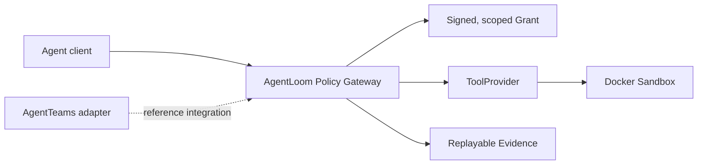

<p align="center">
  
</p>

# AgentLoom

简体中文 | [English](README.en.md)

## TL;DR

AgentLoom 是一个 **Agent Tool Policy Gateway** 原型。当 Agent 想调用工具（改代码、跑测试、写文件）时，Gateway 强制校验：调用方身份 / 短时一次性授权 / 参数白名单 / 审批 / 沙箱 / 可回放证据。任何一项不通过 = 拒绝并留证据。

**这个项目展示的工程能力**：多 Agent 系统的边界设计、HMAC 签名授权、防重放 nonce、不可变 Docker 沙箱、可观测证据链和 Pydantic 契约测试。可以先运行无模型 Demo，再查看分层验证证据。

**招聘者快速查看**：[两分钟项目速览](docs/portfolio-brief.zh-CN.md) · [公开 Demo（3:41）](docs/demo.html) · [无模型快速开始](#无模型快速开始)

## 为什么做这个

2026 年的 Agent 已经能写代码、改 bug、跑测试。但**它们能不能被信任**，是另一个问题。一次工具调用出错就可能删错文件、跑错测试、泄露密钥。AgentLoom 解决的是 Agent 工具调用层的可治理性——给 Agent 调用工具加上"权限校验 + 不可抵赖的证据"，让 Agent 在工程团队里可被审计、可被回滚、可被审批。

## 当前验证状态

| 范围 | 结果 | 说明 |
| --- | --- | --- |
| 本地 Lite | `382 passed / 3 skipped` | 当前 PR 工作树的默认测试；跳过项需要 Docker。 |
| GitHub Actions Full | `380 passed / 0 skipped` | 已验证的 public `main` 基线；本次 PR 尚待 CI 运行。 |
| Task 24 基准 | `6 PASSED / 0 NOT_RUN` | 三个案例分别在两种模式下完成。 |

这些数字描述不同验证环境，不能互相替代。完整历史记录和发布摘要见[验证证据](docs/verification-baseline.zh-CN.md)。

## 项目定位

- 问题：Agent 可以调用工具，但默认缺少可验证的身份、权限和结果边界
- 核心：Policy Broker、SkillExecutionGrant、ToolProvider、Docker Sandbox、Evidence
- 参考集成：AgentTeams/HiClaw `v1.1.2`、Higress Streamable HTTP、Matrix 和 MinIO
- 关键验证：合法调用成功，越权路径、参数篡改、身份不匹配和 Grant 重放被拒绝
- 产品边界：不做代码审查产品，不做 Agent 编排器，不替代 OpenCodeReview 或 AgentTeams

## 验证证据

受治理 ToolCall 的端到端记录、Task 24 基准和历史发布证据见
[验证基线与历史记录](docs/verification-baseline.zh-CN.md)。竞赛材料另见
[初赛提交记录](docs/competition/agentloom-preliminary-submission.md)。Gateway 的目标边界和迁移计划见[产品规格](docs/specs/agent-tool-policy-gateway.md)。

## 架构



Gateway 不信任 Agent 自己声明的身份、路径或成功结果。每次受治理 ToolCall 必须
同时具备已认证 Principal、短时有效且单次使用的 `SkillExecutionGrant`、规范化参数
摘要和 Provider 约束。Gateway 持久化 nonce 消费记录和可回放事件摘要，并把不可信
pytest 放入全新、禁网、只读挂载工作区的 Docker 沙箱运行。

完整设计见 [AgentLoom 架构设计](docs/architecture/agentloom-architecture.md)。

## 无模型快速开始

前置条件：Windows 10/11、PowerShell 7、Python 3.12 和 Git。以下命令不会调用模型或付费 API。

完整的单入口流程（安装、确定性 Demo、预期输出、证据位置和故障排查）见
[Windows 快速开始](docs/deployment/quickstart.md)。

```powershell
python -m venv .venv
.venv\Scripts\python -m pip install -e ".[dev]"
.venv\Scripts\python -m pytest
.venv\Scripts\ruff check .
.venv\Scripts\mypy src tests
```

无需 LLM 或云额度即可运行任一确定性修复案例：

```powershell
.venv\Scripts\python -m agentloom.mock_repair `
  --case-root .\demo\cases\severity-normalization `
  --output-root .\artifacts\demo\severity-normalization
```

将 `severity-normalization` 替换成 `pagination-boundary` 即可运行第二个案例。
查看 Demo 的验证摘要：

```powershell
Get-Content .\artifacts\demo\severity-normalization\artifacts\test-results.txt
```

本地证据控制面板的启动方式为：

```powershell
.venv\Scripts\agentloom tui
```

清洁 clone 的失败关闭门禁只有一个入口：
[`scripts/verify-clean-reproduction.ps1`](scripts/verify-clean-reproduction.ps1)。
它创建全新证据、运行确定性 Demo 和全部质量门禁，并输出脱敏 JSON 摘要及 SHA-256。
详见[清洁环境复现指南](docs/deployment/clean-environment-reproduction.md)和
[五分钟快速开始](docs/deployment/quickstart.md)。

## AgentTeams 参考集成

AgentTeams 部署、Provider 激活、Policy Broker、Higress 和严格 E2E 的历史验证说明位于
[deploy/agentteams/README.md](deploy/agentteams/README.md)。Full 模式要求预先安装
锁定版本的 AgentTeams/HiClaw `v1.1.2`；当前仓库还没有声称提供生产级的独立
Gateway 发行版。

已固化的维护者付费证据只使用 MiniMax。新的 Live 探测可按场景选择 MiniMax 或
StepFun，但必须使用唯一 run ID 并记录准确 Provider/模型。下游管理员也可以用
自己的额度，通过经过验证、使用公共 HTTPS 的
[OpenAI-compatible Provider Profile](docs/specs/openai-compatible-provider-profile.md)
接入 Provider。无密钥 Profile 只保存 Provider 元数据和环境变量名称，不保存 API
Key。Provider 只有通过验证后才会激活，付费连接探测还必须显式开启确认开关。

Provider Profile 验证只证明配置结构正确。配置、连接测试和严格 AgentTeams E2E
是三个独立门禁。“OpenAI-compatible”并不证明任意模型都支持所需的角色消息、
流式输出、工具调用、reasoning 参数、上下文长度或修复行为。厂商私有协议需要单独
实现 Adapter，不能直接视为即插即用。

## 已实现能力

- 面向 Skill、Tool 和 Verifier 的稳定 Capability、Provider、Consumer 边界，
  不同实现复用同一组契约测试
- Agent 身份、Skill 元数据、Evidence、验证、检测、Grant、任务和可回放任务事件的
  严格 Pydantic 契约
- HMAC 签名 Grant：绑定有效期、Consumer、审批、参数并防重放；Broker 重启后仍
  持久化已消费 nonce 摘要
- 失败关闭的检测流水线和确定性 L1 Skill 检查
- 具有来源锁定、严格 Schema 和发布/隔离状态的 Skill 目录：一个上游 Skill 和一个
  团队原创 Skill 已发布，另外四个上游 Skill 隔离
- FastAPI 任务 API、乐观状态迁移、追加式因果事件及可逆 SQLite/Alembic 持久化
- 位于 Higress 身份认证和白名单之后的 Streamable HTTP Policy Broker
- 带请求/结果摘要和本地 Evidence 的受治理 ToolCall 事件
- 运行于锁定镜像中的 pytest Tool Provider：禁网、只读工作区、限制输出和超时，
  并验证容器清理
- 锁定版本的 AgentTeams Manager、三个业务 Agent 身份和 Human 资源
- 无密钥 Provider Profile、无模型校验和显式启用的连接探测
- 绑定精确 Matrix event ID 的 Investigator-to-Verifier 受治理委派
- 确定性本地修复案例、隐藏测试、补丁范围约束、回放查看器和 Textual 证据面板
- Human L2 审批证据，以及仍等待维护者审查的上游 PR #1141 `humanMembers` 修复

## 本地 Broker 开发

创建本地数据库，并用至少 32 字节、仅注入进程环境的开发密钥启动验证型 stdio
Broker：

```powershell
.venv\Scripts\alembic upgrade head
$env:AGENTLOOM_POLICY_SIGNING_KEY = "replace-with-a-local-development-secret"
.venv\Scripts\python -m agentloom.policy_mcp
```

旧的宿主机 pytest runner 只允许用于可信本地开发，并同时要求
`AGENTLOOM_SANDBOX_BACKEND=local-development` 和显式确认
`AGENTLOOM_ALLOW_HOST_TEST_EXECUTION=true`。它不是容器或网络沙箱，绝不能执行
不可信测试。AgentTeams 启动器使用锁定的 Docker 后端，也不会导出该确认变量。
签名密钥、模型凭据和 Provider 原始密钥都不得写入已提交的 MCP、Worker 或 Provider
Profile 配置。

FastAPI 控制面中的 `/internal/*` 路由同样属于受信边界：`create_app` 要求部署方注入
至少 32 个字符的 `internal_api_token`，调用方必须发送
`Authorization: Bearer <token>`。该 token 只应通过进程环境或密钥管理注入；如果服务
被部署到可访问网络，仍需在网关层限制来源并配置 TLS。缺少或错误 token 会返回 `401`，
不会进入任务迁移、审批或 Grant 验证逻辑。

## 项目状态

项目已完成简历版收尾并冻结功能范围。后续只保留两类工作：

1. 修复可复现的质量门禁或安全问题；
2. 只有出现真实试用团队时，才继续实现独立 Gateway profile 或新的 Provider。

第二主机 Full bootstrap 和四个隔离 Skill 的评测属于未完成的历史扩展项，
不作为当前项目完成度或生产能力声明。

## 开源与来源

AgentLoom 代码采用 Apache-2.0 许可证。上游运行时、Skill 内容、依赖和设计参考保留
各自许可证及署名要求。详见 [THIRD_PARTY.md](THIRD_PARTY.md)、
[provenance/sources.yaml](provenance/sources.yaml) 和 [CHANGELOG.md](CHANGELOG.md)。

## 安全

MVP 阶段只使用合成 fixture 和隔离仓库。不要把个人 SSH 目录、生产凭据或无关主机
路径挂载到 Worker 或沙箱。安全问题请私下联系仓库所有者。


