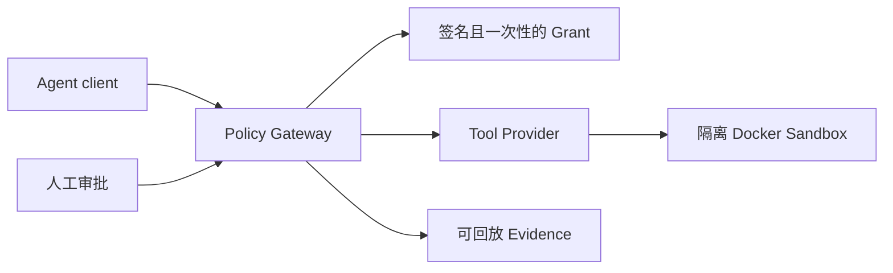

# AgentLoom｜招聘者项目速览

> 一个面向 Agent 工具调用的 **Policy Gateway 原型**：在 Agent 改代码、跑测试或写文件前，强制经过身份校验、短时授权、参数范围约束、审批和隔离执行，并留下可回放证据。

## 30 秒了解它解决什么问题

能调用工具的 Agent 不等于可信的 Agent。一次越权的文件写入、参数篡改或被重放的授权都可能把错误扩大到宿主机。AgentLoom 将这些风险收敛在 ToolCall 边界：不满足策略的调用失败关闭，满足策略的调用保留可审计证据。

## 架构与一次受治理调用



一次调用必须同时具有已认证的调用身份、绑定调用方/参数摘要/有效期的 HMAC Grant，以及未被消费过的 nonce。对不可信的 pytest，Provider 在禁网、只读工作区和锁定镜像中执行；请求与结果摘要写入 Evidence，供独立复核。

## 可以直接核验的证据

| 证据 | 如何查看 |
| --- | --- |
| 3 分 41 秒公开演示 | [在线播放页](demo.html)；包含一次从任务到验证和证据查看的完整演示。 |
| 无模型本地案例 | 按 [README 的快速开始](../README.md#无模型快速开始) 运行；不需要模型额度。 |
| 自动化质量门 | 当前公开 README 记录冻结 `v0.1.0` 门禁为 375 passed / 3 skipped，并链接到完整复现入口与历史证据。 |
| 失败边界 | 路径越权、参数篡改、身份不匹配和 Grant 重放均应被拒绝；测试目录与架构文档可交叉查看。 |

## 我负责的部分

这是我的个人 GoAI 参赛项目。我负责把“Agent 可以调用工具，谁来约束它”收敛为威胁模型、权限边界和验收标准；设计 Grant、审批、沙箱与 Evidence 的契约，并完成确定性 Demo、测试与提交证据的整理。实现过程使用 AI 辅助开发，但架构边界、验证口径和最终验收均以仓库中的测试、运行记录和设计文档为准。

## 本地运行

前置条件：Python 3.12、Git；完整 Docker/AgentTeams 参考集成不是体验核心机制的前提。

```powershell
python -m venv .venv
.venv\Scripts\python -m pip install -e ".[dev]"
.venv\Scripts\python -m agentloom.mock_repair `
  --case-root .\demo\cases\severity-normalization `
  --output-root .\artifacts\demo\severity-normalization
```

更多架构、测试命令和安全边界见 [README](../README.md) 与[架构文档](architecture/agentloom-architecture.md)。这是用于展示可治理 Agent 工具调用边界的原型，不声称已是生产级独立 Gateway。
